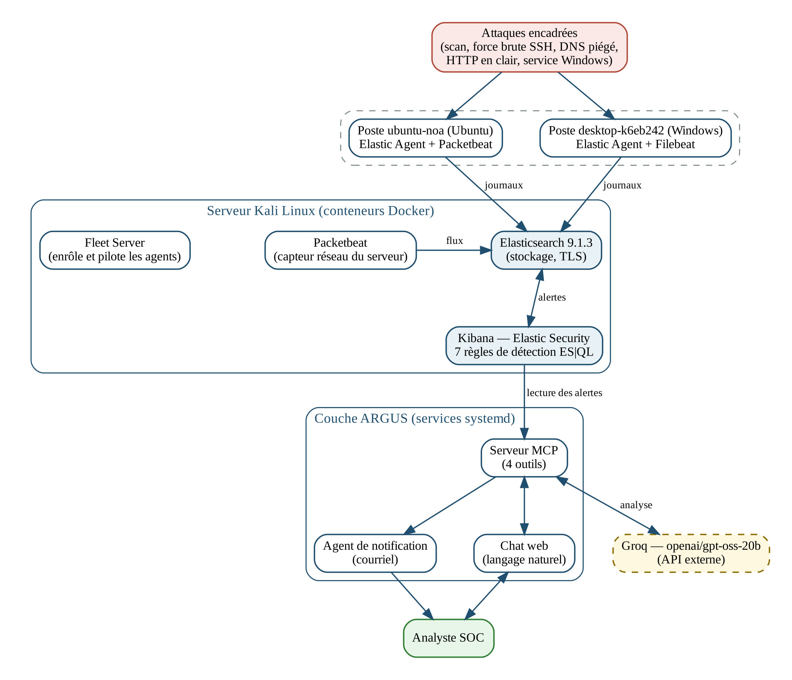

# ARGUS — SOC léger augmenté par l'IA

ARGUS est un **SOC minimaliste** bâti sur la pile Elastic (ELK) 9.1.3 et augmenté
d'un serveur **MCP** (Model Context Protocol) qui expose des outils d'investigation
à un **LLM** (Groq). Il se compose d'un **chat d'analyse** pour l'analyste SOC et d'un
**agent courriel** de notification automatique.

> ⚠️ **Données de test — laboratoire personnel.** Ce dépôt décrit un environnement de
> laboratoire. Toutes les données, adresses et volumes sont des données de test.
> Aucun secret réel n'est versionné (voir `.gitignore` et `elk/.env.example`).

## Architecture



```
        ┌─────────────┐     ┌─────────────┐
        │ ubuntu-noa  │     │  Windows    │    capteurs (Elastic Agent / Beats)
        └──────┬──────┘     └──────┬──────┘
               │                   │
               ▼                   ▼
        ┌──────────────────────────────────┐
        │   Elasticsearch 9.1.3  (ELK)     │  logs-* , alertes SIEM
        │   + Kibana 9.1.3 + Fleet Server  │
        └──────┬───────────────────────────┘
               │ API
               ▼
        ┌─────────────┐   MCP    ┌──────────────┐   LLM   ┌────────┐
        │  mcp_server │◄────────►│  chat_soc    │◄───────►│  Groq  │
        │ :8700       │          │  :8001       │         └────────┘
        └──────┬──────┘          └──────────────┘
               │
               ▼
        ┌───────────────────┐
        │ soc_email_agent   │  notification courriel
        └───────────────────┘
```

## Composants et ports

| Composant | Rôle | Écoute |
|---|---|---|
| Elasticsearch 9.1.3 | Stockage, recherche, alertes SIEM | `127.0.0.1:9200` (TLS) |
| Kibana 9.1.3 | Console, gestion des 7 règles SIEM | `127.0.0.1:5601` (TLS) |
| Fleet Server 9.1.3 | Gestion des agents (Ubuntu / Windows) | `0.0.0.0:8220` |
| Serveur MCP | Outils d'investigation exposés au LLM | `127.0.0.1:8700` |
| Chat analyste | Interface web (Basic Auth) | `0.0.0.0:8001` |
| Agent courriel | Notification e-mail des alertes | via MCP |

## Arborescence du dépôt

```
argus-repo/
├── argus/            # code applicatif (Python + shell)
├── elk/              # docker-compose + configs + .env.example
├── systemd/          # unités de service
├── scripts/          # déploiement + tests encadrés
│   └── tests/
├── regles/           # export NDJSON des règles SIEM
├── docs/             # schéma, manifeste, journal
├── requirements.txt  # dépendances Python (freeze)
├── .gitignore
└── README.md
```

## Installation

1. **Pré-requis** : Docker + `docker compose`, Python 3, `systemd`, ELK 9.1.3.
2. **Dépôt et dépendances**
   ```bash
   git clone <votre-fork> argus-repo && cd argus-repo
   python3 -m venv venv && . venv/bin/activate
   pip install -r requirements.txt
   ```
3. **Secrets** : copier `elk/.env.example` vers les emplacements réels, remplacer les
   `changeme`, puis `chmod 600`.
   ```bash
   cp elk/.env.example /opt/elk/.env            # ES/Kibana (stack Docker)
   cp elk/.env.example /etc/argus-chat.env      # chat
   cp elk/.env.example /etc/argus-email-mcp.env # agent courriel
   cp elk/.env.example ~/.elklab_env            # MCP
   ```
4. **Pile ELK**
   ```bash
   docker compose -f elk/docker-compose.yml up -d
   ```
5. **Services ARGUS**
   ```bash
   sudo cp systemd/*.service /etc/systemd/system/
   sudo systemctl daemon-reload
   sudo systemctl enable --now argus-mcp argus-chat argus-email-mcp
   ```

## Lancer les services

```bash
sudo systemctl status  argus-mcp argus-chat argus-email-mcp
sudo systemctl restart argus-chat          # après modification du chat

# Vérifications
curl -s -o /dev/null -w '%{http_code}\n' http://127.0.0.1:8001/   # 401 sans auth
```

## Scénarios de test

Les règles SIEM sont versionnées dans `regles/argus_rules.ndjson` et peuvent être
réimportées via l'API Kibana (`/api/detection_engine/rules/_import`).

| Règle | Type d'événement |
|---|---|
| `ARGUS - DNS suspect (typosquatting/nominal anormal)` | requêtes DNS vers des domaines piégés |
| `ARGUS - Brute force SSH (T1110, niveau réseau)` | échecs d'authentification SSH |
| `ARGUS - Trafic sensible en clair (HTTP non-TLS)` | HTTP non chiffré |
| `ARGUS - Ransomware : service créé depuis un emplacement insaisissable (T1543.003)` | événement Windows 7045 |
| `ARGUS - Scan de ports (capteur hôte)` / `(VM ubuntu-noa)` | balayage réseau |
| `ARGUS - Connexion à services sensibles (IoMT/infra critique)` | accès à des services sensibles |

**Simulation d'attaques (encadrée, laboratoire) :**
```bash
sudo ./scripts/tests/simuler_pic_alertes.sh 25 argus-demo
```
Ce script génère, **depuis la VM capteur**, de vraies requêtes DNS de test vers des
domaines piégés (typosquatting) afin de déclencher la règle « DNS suspect ». Il lit
ses identifiants d'accès VM **hors du dépôt** (fichier `/opt/argus/vm_ssh_creds` ou
variables `ARGUS_VM_*`).

## Limites connues

- **Licence Basic** : pas de purge d'alertes via l'interface.
- **Cluster mono-nœud** : état `yellow` (répliques non assignées).
- **Règle DNS** : volontairement large (TLD variés) → génère du bruit.
- **Couverture inégale** : certains scénarios (scan, brute force, DNS, HTTP) ne sont
  pas rejoués sur l'agent Windows.
- Certaines unités (`argus-legacy-ip`, `argus-socat-9200`) sont des **contournements
  propres au laboratoire** (IP historique / Elasticsearch en loopback).
